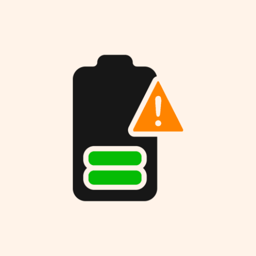

# Battery Notifier


> A lightweight Android application that monitors your battery level and notifies you when it reaches a user-defined target, helping you optimize charging cycles and protect battery health.

---

## 📸 Preview

**Main Interface**

*(Note: Replace with actual app screenshots for better visualization)*

---

## 📖 About This Project

Battery Notifier is designed for users who want to maintain their device's battery health by avoiding overcharging. The app allows users to set a custom target battery percentage (e.g., 80%) and provides a loud, full-screen notification once that level is reached while charging. It utilizes background services and alarm managers to ensure reliable monitoring even when the app is not in the foreground.

Technical Highlights:
- **Foreground Services & Broadcast Receivers** for reliable background monitoring.
- **AlarmManager** for battery-efficient periodic checks.
- **Material Design 3** implementation for a modern look and feel.
- **Dynamic UI** updates with real-time battery status.

---

## ✨ Features

- 🔋 **Live Battery Tracking** - Real-time monitoring of current battery percentage.
- 🎯 **Custom Target Alerts** - Easily set a target battery level using an intuitive slider.
- 🔔 **Smart Notifications** - Receive instant alerts when your target battery level is reached.
- 🔌 **Auto-Scheduling** - Automatically schedules monitoring when the charger is connected.
- ⚡ **Battery Health** - Help prolong battery lifespan by avoiding overcharging.
- 🎨 **Material UI** - Clean and modern interface built with Google's Material Design components.

---

## 🛠️ Tech Stack

| Layer | Technology |
|-------|-----------|
| Framework | [Android SDK 35](https://developer.android.com/) |
| UI Components | [Material Components 1.12.0](https://material.io/develop/android) |
| Styling | [Vanilla XML / Material Design 3](https://m3.material.io/) |
| Language | [Kotlin 1.9.24](https://kotlinlang.org/) |
| Build System | [Gradle 8.8.1](https://gradle.org/) |

---

## 📋 Prerequisites

- [Android Studio](https://developer.android.com/studio) **Ladybug or higher**
- [JDK](https://www.oracle.com/java/technologies/downloads/) **11 or higher**
- [Android Device/Emulator](https://developer.android.com/studio/run/emulator) running **API 24 (Nougat) or higher**

---

## ⚙️ Getting Started

### 1. Clone the repository

```bash
git clone https://github.com/PramudithaN/Battery-Notifier.git
cd Battery-Notifier
```

### 2. Open with Android Studio

1. Launch Android Studio.
2. Select **Open** and navigate to the `Battery-Notifier` folder.
3. Wait for Gradle sync to complete.

### 3. Build and Run

1. Select your device/emulator from the toolbar.
2. Click the **Run** button (green play icon) or press `Shift + F10`.

---

## 📦 Available Scripts

| Command | Description |
|---------|-------------|
| `./gradlew assembleDebug` | Build the debug APK |
| `./gradlew installDebug` | Install the debug APK on the connected device |
| `./gradlew test` | Run unit tests |
| `./gradlew connectedAndroidTest` | Run instrumented tests on a device |
| `./gradlew clean` | Clean the build directory |

---

## 📁 Project Structure

```
Battery-Notifier/
├── app/                        # Main application module
│   ├── src/main/java/          # Kotlin source code
│   │   └── com/pramuditha/
│   │       └── batterynotifier/ # Core logic & UI controllers
│   ├── src/main/res/           # Layouts, drawables, & UI resources
│   └── build.gradle.kts        # App-specific build configuration
├── gradle/                     # Gradle wrapper & version catalogs
├── build.gradle.kts            # Project-wide build configuration
├── settings.gradle.kts         # Project & module definitions
└── gradlew                     # Gradle wrapper executable
```

---

## 🙋‍♂️ Connect with Me

- **GitHub**: [github.com/PramudithaN](https://github.com/PramudithaN)
- **LinkedIn**: [linkedin.com/in/pramuditha-nadun-612b1b204](https://linkedin.com/in/pramuditha-nadun-612b1b204)
- **Email**: pramudithanadun@gmail.com

---

*Developed with ❤️ by Pramuditha Nadun.*
